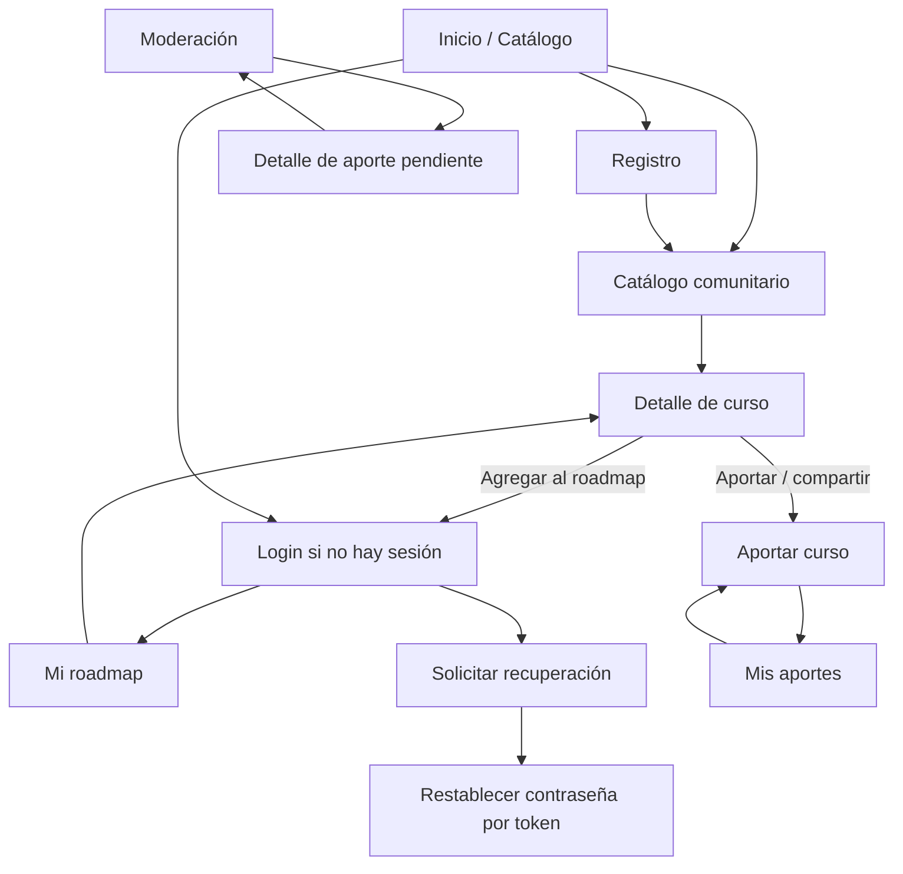

# APPFlow — Mapa del sitio y flujos de usuario — RutaLibre

## 1. Sitemap

El sitemap muestra destinos funcionales, no implica que todas las rutas estén accesibles sin autenticación. La autorización real la aplica el backend.

## 2. Rutas

| Ruta | Acceso | Propósito | Fuente de datos principal |
|---|---|---|---|
| `/` | Público | Redirige o muestra catálogo principal. | `GET /api/v1/courses` |
| `/catalogo` | Público | Buscar, filtrar y paginar cursos publicados. | `GET /api/v1/courses`, `GET /api/v1/categories` |
| `/catalogo/:courseId` | Público si publicado | Detalle de curso. | `GET /api/v1/courses/{course_id}` |
| `/registro` | Público | Crear cuenta. | `POST /api/v1/auth/register` |
| `/login` | Público | Iniciar sesión. | `POST /api/v1/auth/login` |
| `/recuperar` | Público | Solicitar email de recuperación. | `POST /api/v1/auth/password/forgot` |
| `/restablecer?token=...` | Público con token válido | Elegir contraseña nueva. | `POST /api/v1/auth/password/reset` |
| `/aportar` | Usuario autenticado | Enviar curso a revisión. | `POST /api/v1/contributions` |
| `/mis-aportes` | Usuario autenticado | Ver aportes propios y estados. | `GET /api/v1/me/contributions` |
| `/roadmap` | Usuario autenticado | Ver roadmap privado y actualizar estados. | `GET /api/v1/me/roadmap`, `PATCH/DELETE /api/v1/me/roadmap/{item_id}` |
| `/moderacion/aportes` | Moderator | Cola paginada de aportes pendientes. | `GET /api/v1/moderation/contributions` |
| `/moderacion/aportes/:contributionId` | Moderator | Revisar y resolver aporte. | `GET /api/v1/moderation/contributions/{id}`, `POST /api/v1/moderation/contributions/{id}/decision` |
| `/cuenta` | Usuario autenticado | Ver datos básicos y cerrar sesión. | `GET /api/v1/auth/me`, `POST /api/v1/auth/logout` |

## 3. Fichas de pantalla

### Pantalla: Catálogo comunitario (`/catalogo`)

- **Objetivo:** encontrar cursos publicados sin iniciar sesión.
- **Contenido:** título, campo de búsqueda, filtros por categoría/tema/certificado, tarjetas, total de resultados y paginador.
- **Acciones:** abrir detalle; iniciar sesión; navegar a registro; aportar (requiere autenticación).
- **Estados:** carga, resultados, sin resultados, catálogo vacío, error de red, error de parámetros.
- **Reglas:** no mostrar aportes pendientes/rechazados; la API siempre limita resultados y verifica filtros.

### Pantalla: Detalle de curso (`/catalogo/:courseId`)

- **Objetivo:** presentar metadatos comparables para decidir si realizar el curso.
- **Contenido:** título, categoría, tema, versión, año, docentes, proveedor/URL, declaración de toma del aportante en forma agregada/no identificatoria, cuestionarios, examen, certificado y aval.
- **Acciones:** abrir proveedor en pestaña externa; agregar al roadmap si autenticado; si visitante, enviar a login conservando retorno seguro a detalle.
- **Estados:** carga, curso no encontrado/no publicado, error de red, agregado correctamente, ya estaba en roadmap.
- **Reglas:** solo se consulta un curso publicado; el backend valida estado al agregarlo.

### Pantalla: Aportar curso (`/aportar`)

- **Objetivo:** enviar un curso gratuito con datos completos.
- **Contenido:** campos obligatorios de curso; radios Sí/No para cuestionario, examen, certificado y aval; nombre de organización condicional; declaración “Lo realicé / No lo realicé”.
- **Acciones:** validar, enviar, cancelar y revisar mensaje de resultado.
- **Estados:** vacío, validación local, error backend por campo, enviando, enviado y pendiente de revisión, URL duplicada.
- **Reglas:** ruta protegida por UX y endpoint protegido por sesión; backend valida todo, URL canónica y duplicados.

### Pantalla: Mi roadmap (`/roadmap`)

- **Objetivo:** organizar el aprendizaje personal.
- **Contenido:** lista paginada de cursos agregados, estado y acciones.
- **Acciones:** abrir detalle, cambiar estado a `planned`/`in_progress`/`completed`, quitar curso, ir al catálogo.
- **Estados:** carga, vacío, contenido, error, confirmación al quitar.
- **Reglas:** el backend filtra por usuario de la sesión; nunca acepta `user_id` arbitrario del cliente para determinar propiedad.

### Pantalla: Login (`/login`)

- Email y contraseña; mostrar/ocultar contraseña accesible; enlace a recuperación y registro.
- Mensaje genérico ante credenciales inválidas; HTTP 429 muestra tiempo de espera sin revelar si el email existe.
- Tras login exitoso, redirigir al `returnTo` solo si es una ruta interna permitida; de lo contrario, catálogo.

### Pantalla: Registro (`/registro`)

- Email, contraseña y confirmación de contraseña en cliente; política de contraseña visible.
- Backend crea usuario y sesión (decisión MVP); email duplicado recibe mensaje claro de registro, sin exponer información en endpoints de recuperación.
- Tras alta, catálogo con sesión iniciada.

### Pantalla: Recuperación (`/recuperar`, `/restablecer`)

- Solicitud muestra mensaje genérico siempre.
- Formulario de nueva contraseña requiere token vigente y contraseña que cumpla política.
- Token vencido/usado muestra opción para solicitar otro; no se muestra el token en logs.

### Pantalla: Moderación (`/moderacion/aportes`)

- Acceso solo `moderator`; listado paginado de aportes `pending_review`.
- Detalle incluye todos los metadatos, URL externa y aportante interno solo si es necesario para moderar.
- Aprobar o rechazar; rechazo requiere motivo. La acción es transaccional y registra moderador/fecha.

## 4. Flujos de usuario

### Flujo 1 — Aportar un curso al catálogo

1. Usuario inicia sesión o se registra.
2. Abre “Aportar curso” y completa campos requeridos.
3. Frontend valida formatos y campos para ayudar; backend vuelve a validar.
4. Backend normaliza URL y verifica duplicados.
5. Si es válido, crea aporte `pending_review` y responde con identificador/estado.
6. UI muestra “Aporte enviado; está pendiente de revisión” y lo incluye en Mis aportes.
7. El curso no aparece en catálogo hasta la decisión de moderación.

**Alternativas:** campo inválido → errores por campo; URL duplicada → mensaje de duplicado; sesión vencida → login y retorno al formulario si es seguro; fallo de red → conservar valores del formulario.

### Flujo 2 — Descubrir un curso y agregarlo a mi roadmap

1. Visitante abre catálogo, busca y filtra cursos.
2. Navega a detalle de un curso publicado.
3. Pulsa “Agregar al roadmap”.
4. Si no hay sesión, se dirige a login y luego vuelve al detalle.
5. Backend verifica sesión, publicación y ausencia de duplicado.
6. Se crea `roadmap_item` con estado `planned` y se confirma la acción.
7. El usuario puede ir a Mi roadmap y cambiar estado.

**Alternativas:** curso ya agregado → mensaje idempotente o 409 con mensaje “Ya está en tu roadmap”; curso despublicado entre lectura y agregado → rechazo y vuelta al catálogo.

### Flujo 3 — Validación de un aporte

1. Moderador autenticado abre la cola de aportes pendientes.
2. Abre un aporte y revisa metadatos, URL y gratuidad aparente.
3. Selecciona aprobar o rechazar.
4. Si rechaza, ingresa motivo obligatorio.
5. Backend comprueba rol y que el aporte siga pendiente, registra decisión, moderador y fecha.
6. Aprobación crea/publica el curso visible; rechazo no lo publica y el aportante puede ver el motivo.

**Alternativas:** otro moderador ya resolvió → conflicto de estado y recarga; rol insuficiente → 403; lista vacía → estado vacío.

### Flujo 4 — Registro y primeros pasos

1. Visitante elige Registrarse.
2. Completa email y contraseña.
3. Backend normaliza email, valida política, aplica rate limit y crea cuenta.
4. Se crea sesión; frontend muestra catálogo con navegación autenticada.
5. Usuario puede agregar cursos existentes o aportar uno nuevo.

### Flujo 5 — Recuperar contraseña

1. Usuario solicita recuperación desde login.
2. Backend aplica rate limit y devuelve mensaje genérico.
3. Si la cuenta existe, genera token aleatorio, guarda hash y envía enlace con expiración de 30 minutos.
4. Usuario abre enlace y establece contraseña nueva.
5. Backend verifica hash, vencimiento y uso previo; cambia hash de contraseña, marca token usado e invalida sesiones anteriores.
6. UI confirma y solicita iniciar sesión nuevamente.

## 5. Estados globales de la app

- **Sesión:** desconocida/cargando, autenticada, anónima, vencida. Si vence, redirigir a login conservando ruta interna segura.
- **Conectividad:** carga, éxito, vacío, error recuperable y error de autorización. No convertir errores 401/403 en pantalla vacía.
- **Mensajes:** feedback de éxito/error con texto y accesibilidad; evitar duplicar toasts y mensajes inline.
- **Permisos:** menú y botones se adaptan a rol, pero los endpoints vuelven a validar rol y propiedad.
- **Paginación:** query parameters `limit`/`offset` o equivalentes se reflejan en estado de pantalla; cambios de filtro reinician offset.
- **Rutas no encontradas:** página 404; curso inexistente o no publicado usa mensaje genérico.

---

**Contrato de coherencia:** cada ruta que lee o modifica datos está mapeada a endpoints de [BackendSchema.md](BackendSchema.md). Cada historia P0 tiene tarea en [IMPLEMENTATION_PLAN.md](IMPLEMENTATION_PLAN.md).
