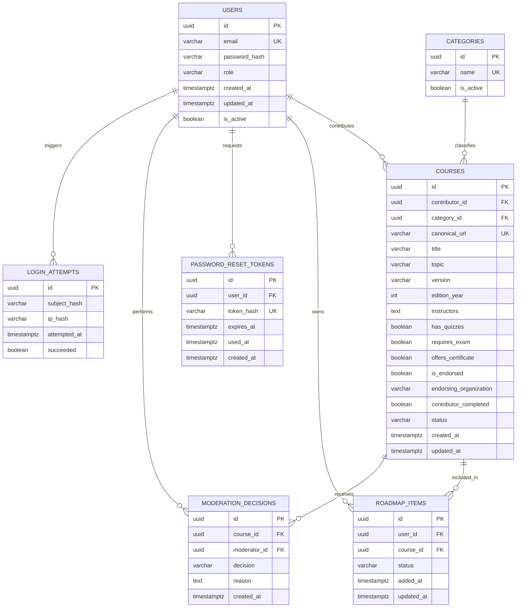
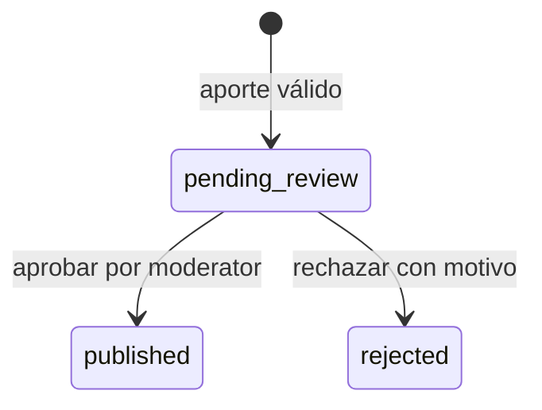

# BackendSchema — Esquema de base de datos y APIs — RutaLibre

## 1. Modelo de datos

### 1.1 Diagrama entidad-relación (Mermaid)

`LOGIN_ATTEMPTS` representa una opción simple de auditoría/ventana de rate limit; el almacenamiento real puede usar una tabla de ventanas/counters para actualización atómica. Nunca almacenar la contraseña ingresada. `ip_hash` y `subject_hash` reducen exposición de identificadores, con política de retención corta.

### 1.2 Tablas (una por entidad)

#### `users`

| Campo | Tipo | Restricción / propósito |
|---|---|---|
| `id` | UUID | PK. |
| `email` | VARCHAR(254) | NOT NULL, UNIQUE, normalizado a minúsculas y espacios exteriores eliminados. |
| `password_hash` | VARCHAR(255) | NOT NULL; hash Argon2id recomendado o bcrypt como mínimo. Nunca devolver por API. |
| `role` | VARCHAR(20) | NOT NULL, default `user`, CHECK `user`/`moderator`. No se puede modificar desde registro público. |
| `is_active` | BOOLEAN | NOT NULL, default true. |
| `created_at`, `updated_at` | TIMESTAMPTZ | NOT NULL; timestamps UTC. |

#### `categories`

| Campo | Tipo | Restricción / propósito |
|---|---|---|
| `id` | UUID | PK. |
| `name` | VARCHAR(80) | NOT NULL, UNIQUE, no vacío. |
| `slug` | VARCHAR(100) | NOT NULL, UNIQUE, URL-safe. |
| `is_active` | BOOLEAN | NOT NULL, default true. |

Categorías iniciales seed sugeridas: Programación, Datos, Sistemas, Redes, Seguridad, Diseño, Negocios, Idiomas, Ciencias, Otros. El catálogo de categorías lo administra el seed durante MVP; no se ofrece CRUD público de categorías.

#### `courses`

| Campo | Tipo | Restricción / propósito |
|---|---|---|
| `id` | UUID | PK. |
| `contributor_id` | UUID | FK a `users.id`, NOT NULL, index. |
| `category_id` | UUID | FK a `categories.id`, NOT NULL. |
| `canonical_url` | VARCHAR(2048) | NOT NULL, UNIQUE; URL normalizada. |
| `source_url` | VARCHAR(2048) | NOT NULL; URL original para navegación. |
| `provider` | VARCHAR(160) | Opcional; proveedor/plataforma derivado o declarado. |
| `title` | VARCHAR(200) | NOT NULL. |
| `topic` | VARCHAR(160) | NOT NULL. |
| `version` | VARCHAR(80) | NOT NULL. |
| `edition_year` | SMALLINT | NOT NULL; 1900 a año actual + 1. |
| `instructors` | TEXT | NOT NULL; nombre(s) de docentes/disertantes, con límite de longitud validado en API. |
| `has_quizzes` | BOOLEAN | NOT NULL; respuesta explícita sí/no. |
| `requires_exam` | BOOLEAN | NOT NULL. |
| `offers_certificate` | BOOLEAN | NOT NULL. |
| `is_endorsed` | BOOLEAN | NOT NULL. |
| `endorsing_organization` | VARCHAR(200) | Nullable; requerido si `is_endorsed=true`. |
| `contributor_completed` | BOOLEAN | NOT NULL; declaración del aportante. |
| `status` | VARCHAR(24) | NOT NULL; `pending_review`, `published`, `rejected`. |
| `rejection_reason` | TEXT | Nullable; requerido en rechazo. |
| `reviewed_by` | UUID | FK nullable a `users.id`; moderador que resolvió. |
| `reviewed_at` | TIMESTAMPTZ | Nullable. |
| `created_at`, `updated_at` | TIMESTAMPTZ | NOT NULL. |

Índices: `status, created_at DESC`; `category_id, status`; `title` (índice normal; búsqueda full-text puede ser mejora); `contributor_id, created_at DESC`. Restricción: si `status='rejected'`, `rejection_reason` no debe ser vacío; si `status='published'`, `reviewed_by` y `reviewed_at` no nulos.

#### `roadmap_items`

| Campo | Tipo | Restricción / propósito |
|---|---|---|
| `id` | UUID | PK. |
| `user_id` | UUID | FK `users.id`, NOT NULL. |
| `course_id` | UUID | FK `courses.id`, NOT NULL. |
| `status` | VARCHAR(20) | NOT NULL, default `planned`; CHECK `planned`, `in_progress`, `completed`. |
| `added_at`, `updated_at` | TIMESTAMPTZ | NOT NULL. |

Restricción `UNIQUE(user_id, course_id)` para impedir duplicados personales. Índice `(user_id, added_at DESC)`. El curso se agrega solo si `courses.status='published'` al momento de la operación.

#### `password_reset_tokens`

| Campo | Tipo | Restricción / propósito |
|---|---|---|
| `id` | UUID | PK. |
| `user_id` | UUID | FK `users.id`, NOT NULL. |
| `token_hash` | VARCHAR(128) | NOT NULL, UNIQUE; nunca persistir token en claro. |
| `expires_at` | TIMESTAMPTZ | NOT NULL, 30 minutos desde creación. |
| `used_at` | TIMESTAMPTZ | Nullable; no nulo tras consumo. |
| `created_at` | TIMESTAMPTZ | NOT NULL. |

Solo puede consumirse si no expiró y `used_at IS NULL`; el consumo y cambio de contraseña se ejecutan en una transacción. Al solicitar otro token, los tokens anteriores de esa cuenta se invalidan.

#### `moderation_decisions`

| Campo | Tipo | Restricción / propósito |
|---|---|---|
| `id` | UUID | PK. |
| `course_id` | UUID | FK `courses.id`, NOT NULL. |
| `moderator_id` | UUID | FK `users.id`, NOT NULL. |
| `decision` | VARCHAR(20) | `approved` o `rejected`. |
| `reason` | TEXT | Obligatorio si rechazado; opcional si aprobado. |
| `created_at` | TIMESTAMPTZ | NOT NULL. |

La tabla conserva historial de decisiones si en una versión futura se habilita reenvío/revisión posterior. Para el MVP se registra la decisión final inicial.

#### `login_attempts` / limitadores

| Campo | Tipo | Restricción / propósito |
|---|---|---|
| `id` | UUID | PK. |
| `subject_hash` | VARCHAR(128) | Hash del email normalizado para contar intentos sin persistirlo en claro. |
| `ip_hash` | VARCHAR(128) | Hash con secreto de configuración de IP de origen. |
| `attempted_at` | TIMESTAMPTZ | NOT NULL, index. |
| `succeeded` | BOOLEAN | NOT NULL. |

Retención objetivo: 24–48 h para intentos detallados, configurable. La consulta de ventana debe ser eficiente y el incremento atómico. No usar esta tabla como auditoría permanente de actividad.

## 2. Estados del ciclo de vida del curso

- `pending_review`: privado al aportante y moderación; no aparece en catálogo público.
- `published`: visible en catálogo público y elegible para roadmap.
- `rejected`: no visible públicamente; el aportante ve el motivo.
- Reenvío/edición de un curso rechazado no se incluye en MVP; el usuario puede corregir y volver a enviar como nuevo aporte solo si la política de duplicados lo permite. Si se decide habilitar edición, debe volver a `pending_review` y quedar auditada.

## 3. API REST

**Convenciones comunes:** prefijo `/api/v1`; JSON; IDs UUID; fechas ISO 8601 UTC. Las listas devuelven `{items, total, limit, offset}`. `limit` default 20 y máximo 100; `offset` default 0 y no negativo. Orden estable. Errores: `{ "error": { "code": "...", "message": "...", "details": {}, "request_id": "..." } }`. El esquema exacto se implementa en TRD §2 TD-004.

### 3.1 Autenticación

| Método y ruta | Auth | Request principal | Respuesta / errores |
|---|---|---|---|
| `POST /auth/register` | Público + rate limit | `{email, password}` | `201` usuario público y sesión; `409` email ya registrado; `422` validación; `429` límite. |
| `POST /auth/login` | Público + rate limit | `{email, password}` | `200` usuario público y cookie de sesión; `401` credenciales inválidas genéricas; `429` + `Retry-After`. |
| `POST /auth/logout` | Sesión | — | `204`; invalida sesión y limpia cookie. |
| `GET /auth/me` | Sesión | — | `200` `{id,email,role}`; `401` si no hay sesión válida. |
| `POST /auth/password/forgot` | Público + rate limit | `{email}` | `202` mensaje genérico siempre; `429` si se excede límite. |
| `POST /auth/password/reset` | Público + rate limit | `{token,new_password}` | `204`; `400` token inválido/vencido/usado; `422` política de contraseña. |

La cookie de sesión es opaca, `HttpOnly`, `SameSite=Lax`, `Secure` en HTTPS y con expiración razonable configurable. Mutaciones autenticadas deben protegerse contra CSRF según topología final; el frontend no almacena tokens en `localStorage`.

### 3.2 Catálogo de cursos

| Método y ruta | Auth | Request/query | Respuesta / errores |
|---|---|---|---|
| `GET /courses` | Público | `limit`, `offset`, `q`, `category_id`, `topic`, `offers_certificate` | Lista paginada solo de `published`. |
| `GET /courses/{course_id}` | Público | UUID path | Detalle público si `published`; `404` para inexistente/no publicado. |
| `GET /categories` | Público | `limit`, `offset` opcionales | Lista paginada de categorías activas. |

La búsqueda inicial puede implementarse con `ILIKE` sobre título, tema, docente y proveedor; parametrizada mediante ORM, con límite máximo y sin concatenar SQL de usuario. La búsqueda full-text es mejora posterior.

### 3.3 Aportes de cursos y validación

| Método y ruta | Auth | Request/query | Respuesta / errores |
|---|---|---|---|
| `POST /contributions` | Usuario | `source_url`, `category_id`, `topic`, `title`, `version`, `edition_year`, `instructors`, `has_quizzes`, `requires_exam`, `offers_certificate`, `is_endorsed`, `endorsing_organization?`, `contributor_completed` | `201` aporte resumido con `pending_review`; `409` URL duplicada; `422` validación. |
| `GET /me/contributions` | Usuario | `limit`, `offset` | Lista paginada solo de aportes propios con estado y motivo. |
| `GET /moderation/contributions` | Moderator | `limit`, `offset`, `status=pending_review` | Cola paginada. Rol incorrecto `403`. |
| `GET /moderation/contributions/{id}` | Moderator | UUID path | Detalle de revisión; `404` si no existe. |
| `POST /moderation/contributions/{id}/decision` | Moderator | `{decision: "approved"|"rejected", reason?}` | `200` estado actualizado; rechazo exige motivo; `409` si ya fue resuelto. |

La revisión comprueba al menos que el curso sea gratuito, la URL sea accesible/pertinente al momento de revisión, los datos sean razonables y no exista duplicado. No se realiza scraping automatizado.

### 3.4 Roadmap del usuario

| Método y ruta | Auth | Request/query | Respuesta / errores |
|---|---|---|---|
| `GET /me/roadmap` | Usuario | `limit`, `offset`, `status?` | Lista paginada con curso publicado y estado personal. |
| `POST /me/roadmap` | Usuario | `{course_id}` | `201` elemento `planned`; `409` ya agregado; `404` curso inexistente/no publicado. |
| `PATCH /me/roadmap/{item_id}` | Usuario | `{status}` | `200` elemento actualizado; `404` si no pertenece al usuario/no existe. |
| `DELETE /me/roadmap/{item_id}` | Usuario | — | `204`; `404` si no pertenece al usuario/no existe. |

No se acepta `user_id` en request para decidir propiedad: se deriva de la sesión autenticada. Las queries de repositorio siempre filtran por usuario actual.

### 3.5 Categorías (lista cerrada)

`GET /categories` es público y paginado. Categorías se inicializan por seed. No existe CRUD de categorías en el MVP; la modificación requiere actualizar seed/migración con revisión. El aporte solo puede referenciar categoría activa.

## 4. Decisiones del esquema

- **Integridad:** FKs, `NOT NULL`, `UNIQUE`, `CHECK` y restricciones se aplican en PostgreSQL además de validación Pydantic.
- **Transacciones:** creación de usuario/sesión, consumo de token y cambio de contraseña, decisión de moderación y agregado de roadmap son operaciones atómicas.
- **Privacidad:** respuestas públicas omiten email/ID del aportante; Mis aportes filtra por sesión; roadmap filtra por sesión; moderación requiere rol.
- **Normalización URL:** solo reglas conservadoras; se quita fragmento y se normaliza host/esquema cuando sea seguro. No eliminar parámetros de query arbitrariamente porque pueden ser parte de la URL real del curso.
- **Borrado:** no borrar físicamente cursos que ya estén en roadmaps sin política; en MVP no se ofrece borrar curso publicado. Si debe retirarse, futuro estado `archived` requiere migración y reglas UI.
- **Auditoría:** registrar moderador y fecha; logs sin tokens ni contraseñas. Los logs de rate limit tienen retención limitada.
- **Paginación:** incluso colas y “Mis aportes” paginan. Orden por `created_at DESC, id DESC` o campo explícito con `id` de desempate.
- **Migraciones:** Alembic versiona el esquema; seed idempotente para categorías y moderador de desarrollo. Credenciales de seed no deben ser de producción ni commitearse como secretos.
- **Índices:** agregar índices a FKs y columnas de filtros; validar consultas reales antes de optimizar más.

---

**Trazabilidad:** RF-001–RF-012 y BR-001–BR-012 en [PRD.md](PRD.md); rutas y flujos en [APPFlow.md](APPFlow.md); implementación por módulos en [IMPLEMENTATION_PLAN.md](IMPLEMENTATION_PLAN.md).
