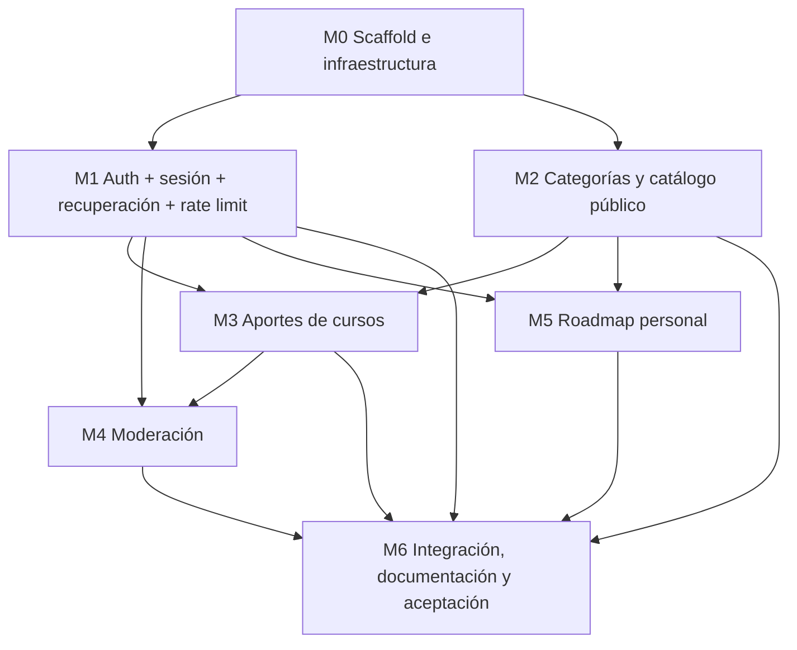

# Implementation Plan — RutaLibre

## 1. MVP — qué es P0

P0 es el conjunto mínimo que debe funcionar end-to-end desde la interfaz en una máquina limpia después de la aprobación docente. El orden respeta dependencias y no habilita escribir código antes del correo **APROBADO** y la recepción del T1.

| Historia | Incluida en MVP P0 | Motivo |
|---|---|---|
| US-001 Catálogo paginado | Sí | Función principal pública. |
| US-002 Detalle del curso | Sí | Permite evaluar curso. |
| US-003 Registro/login/logout y rate limit | Sí | Requisito obligatorio de autenticación. |
| US-004 Recuperación de contraseña | Sí | Requisito explícito de la SPEC. |
| US-005 Aporte de curso | Sí | Aporta contenido al catálogo comunitario. |
| US-006 Agregar curso al roadmap | Sí | Función principal personal. |
| US-007 Cambiar estado/quitar curso | Sí | CRUD del roadmap personal. |
| US-008 Búsqueda/filtros | P1 | Se implementa después de los flujos básicos si el tiempo alcanza; el catálogo P0 sigue paginado. |
| US-009 Moderación | Sí, por necesidad de publicar cursos validados | Aunque la historia se prioriza P1 en PRD por interfaz administrativa, la validación manual es dependencia de producto; se sube a P0 para que el catálogo pueda poblarse de forma completa. |
| US-010 Mis aportes | P1 | No bloquea envío ni revisión, pero mejora transparencia. |
| US-011 Categorías | Sí, versión mínima | Se necesita para formulario; seed y endpoint público. |

La prioridad P0 de US-009 y US-011 coincide con PRD: la moderación es necesaria para que los aportes puedan llegar al catálogo y las categorías son necesarias para completar el formulario.

## 2. Módulos y dependencias

## 3. Detalle por módulo

> Las casillas quedan sin marcar durante la Instancia A. Al ejecutar cada tarea, actualizar el estado con rama y SHA del commit que la completa. No crear archivos fuente antes del gate.

### M0 — Scaffold e infraestructura (P0)

- [ ] M0.1 — Crear estructura Screaming Architecture frontend/backend. **DoD:** carpetas por dominio y capas acordadas, sin módulos monolíticos genéricos. Rama/commit: pendiente.
- [ ] M0.2 — Fijar versiones, crear manifiestos/lockfiles y `.env.example`. **DoD:** versiones reales registradas en TRD, lockfiles reproducibles y sin secretos. Rama/commit: pendiente.
- [ ] M0.3 — Docker Compose con PostgreSQL 18.6, backend y frontend. **DoD:** `docker compose up --build` arranca los tres servicios; puertos y comandos documentados. Rama/commit: pendiente.
- [ ] M0.4 — Configurar SQLAlchemy/Alembic y conexión DB. **DoD:** migración vacía y conexión comprobable; fallo de conexión genera error claro. Rama/commit: pendiente.
- [ ] M0.5 — Seed idempotente de categorías y moderador de desarrollo. **DoD:** repetir seed no duplica categorías; credenciales documentadas solo para entorno local. Rama/commit: pendiente.

### M1 — Autenticación (P0)

- [ ] M1.1 — Modelo de usuario y migración. **DoD:** email único, rol controlado y hash no nulo; nunca se persiste contraseña en claro.
- [ ] M1.2 — Registro/login/logout/`me`. **DoD:** flujos end-to-end, cookie de sesión y respuestas genéricas ante credenciales incorrectas.
- [ ] M1.3 — Rate limit backend. **DoD:** umbrales configurables, HTTP 429/`Retry-After`, contadores atómicos y no bloqueos permanentes.
- [ ] M1.4 — Recuperación por email. **DoD:** solicitud genérica, token hash de un solo uso/30 min, cambio de contraseña e invalidación de sesiones previas.
- [ ] M1.5 — Formularios y estados de auth. **DoD:** validación inline, loading/error/success y navegación coherente.

### M2 — Categorías y catálogo público (P0)

- [ ] M2.1 — Modelo curso/categoría y migraciones. **DoD:** restricciones, índices y estados documentados.
- [ ] M2.2 — `GET /courses`, `GET /courses/{id}`, `GET /categories`. **DoD:** colecciones paginadas; público solo ve `published`; orden estable y validación de query params.
- [ ] M2.3 — Pantallas catálogo y detalle. **DoD:** responsive, estados de carga/vacío/error, enlace externo seguro y paginador visible.
- [ ] M2.4 — Búsqueda y filtros (P1 si tiempo limitado). **DoD:** búsqueda parametrizada, filtros persistentes y offset reiniciado al cambiar filtro.

### M3 — Aportes (P0)

- [ ] M3.1 — Formulario de aporte y schemas. **DoD:** todos los campos requeridos de SPEC; radios Sí/No para características y declaración de toma.
- [ ] M3.2 — Servicio de creación y canonicalización de URL. **DoD:** campos validados, URL duplicada bloqueada por lógica y restricción DB, nuevo estado `pending_review`.
- [ ] M3.3 — `POST /contributions` y UI resultado. **DoD:** solo usuario autenticado; errores de campo y duplicado explicados; curso no publicado automáticamente.
- [ ] M3.4 — `GET /me/contributions` (P1 si el tiempo es limitado). **DoD:** datos propios paginados y motivo de rechazo visible.

### M4 — Moderación (P0 para completar catálogo validado)

- [ ] M4.1 — Cola de aportes pendientes paginada. **DoD:** solo rol moderator; consulta no muestra cursos ya resueltos por defecto.
- [ ] M4.2 — Decisión aprobar/rechazar. **DoD:** rechazo exige motivo; transacción registra moderador/fecha; decisión repetida devuelve conflicto.
- [ ] M4.3 — UI de moderación. **DoD:** detalle completo, confirmación de decisión, estado vacío y errores 403/409 manejados.

### M5 — Roadmap personal (P0)

- [ ] M5.1 — Tabla `roadmap_items` y restricciones. **DoD:** unicidad `(user_id, course_id)` y estados permitidos.
- [ ] M5.2 — Endpoints listar/agregar/actualizar/quitar. **DoD:** cada consulta deriva user_id de sesión; solo cursos publicados; listas paginadas.
- [ ] M5.3 — UI roadmap. **DoD:** vacío con CTA al catálogo; cambiar estado; quitar con confirmación; sin acceso cruzado.
- [ ] M5.4 — Acción agregar desde detalle. **DoD:** login con retorno interno seguro; ya agregado se informa sin duplicar.

### M6 — Integración, README y aceptación P0

- [ ] M6.1 — Repasar trazabilidad PRD ↔ rutas ↔ endpoints ↔ tareas. **DoD:** cada pantalla con API y cada US P0 con tarea/criterios.
- [ ] M6.2 — Errores, permisos y paginación en todos los listados. **DoD:** revisar 401/403/404/409/422/429 y listados.
- [ ] M6.3 — Actualizar README con comandos exactos y seed. **DoD:** instrucciones probadas en entorno limpio, URLs y credenciales de prueba locales sin secretos de producción.
- [ ] M6.4 — Recorrido manual de historias P0. **DoD:** catálogo, auth, recuperación, aporte, moderación y roadmap funcionan desde UI.
- [ ] M6.5 — Actualizar checklist y commits. **DoD:** tareas marcadas con rama/SHA y Conventional Commits; no se declara completado lo no probado.

## 4. Ejecución (Instancia B)

1. Esperar el correo **APROBADO** y el T1; hasta entonces no crear código, lockfiles, `node_modules`, `.venv` ni otros artefactos de implementación.
2. Crear rama `feat/M0-scaffold` y completar M0; merge por Pull Request.
3. Ejecutar módulos según dependencias; cada módulo es una rama o lote coherente con commits específicos.
4. Al terminar cada historia, comprobar criterios de aceptación, actualizar esta lista con `[x]` y registrar rama/commit.
5. Si una decisión de producto cambia, abrir ticket, modificar documentos afectados y después código; no resolver contradicciones solo en implementación.
6. En el cierre, clonar en máquina limpia, seguir README y ejecutar `docker compose up --build`; verificar URLs, seed y todas las historias P0.

## 5. Estrategia de testing

La Instancia B exige verificación end-to-end manual de P0. Los tests unitarios, integración automatizada por capas, Docker multi-stage, `.dockerignore`, optimización de imágenes y healthchecks avanzados son contenido previsto para la clase del 27/10 y no condición de la Instancia B según la consigna.

### Verificaciones manuales mínimas P0

- Visitante lista y abre cursos publicados; no ve pendientes/rechazados; lista con más de 20 resultados pagina.
- Registro crea usuario; email duplicado se maneja; login/logout y cookie funcionan.
- Intentos repetidos de login activan rate limit; el mensaje no revela existencia de cuenta.
- Recuperación funciona con token válido, falla con token vencido/usado y no revela si un email existe.
- Usuario aporta curso completo; campos inválidos y URL duplicada se rechazan; el aporte queda pendiente.
- Moderator aprueba y el curso aparece en catálogo; rechazo exige motivo y no publica.
- Usuario agrega curso a roadmap, cambia estado y lo quita; segundo agregado no duplica.
- Usuario A no puede leer ni modificar roadmap de usuario B ni usar endpoints de moderación.
- Todas las listas de UI/API son paginadas y el menú mobile es usable con teclado.

## 6. Riesgos del plan

| Riesgo | Efecto | Mitigación |
|---|---|---|
| El gate de aprobación reduce el tiempo de desarrollo | No completar MVP antes de fecha límite | Enviar documentación temprano; proteger P0 y dejar filtros/UX secundarios P1. |
| Recuperación depende de email | No poder demostrar ciclo completo | Configurar SMTP de prueba/Mailpit y documentar inspección del correo. |
| Moderación no se prioriza a tiempo | Aportes nunca llegan a catálogo | Tratar M4 como P0 por dependencia de negocio. |
| Incoherencia entre docs | Observación de entrega | Checklist de trazabilidad y revisión cruzada antes de enviar. |
| Datos de prueba insuficientes | No se observa paginación | Seed con más de 20 cursos publicados y casos pending/rejected. |
| Seguridad se resuelve solo en frontend | Acceso no autorizado | Verificar permisos server-side en cada endpoint protegido. |
| Cambio de alcance sin documentación | Código contradice el contrato | Ticket + rama + Conventional Commit + actualización de docs. |

---

**Definition of Done de la Instancia B:** en máquina limpia, `git clone`, lectura del README y `docker compose up` levantan PostgreSQL, backend y frontend; las historias P0 funcionan end-to-end desde la UI. No se afirma cumplido hasta verificarlo.
