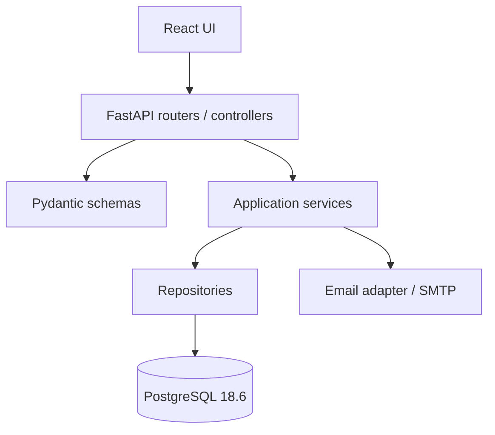

# TRD — Technical Requirements Document — RutaLibre

> Define cómo construir el sistema y por qué. No reemplaza al PRD ni al plan de tareas. Las versiones exactas se deben registrar cuando se habilite la Instancia B; durante la Instancia A no se instalan dependencias ni se crean lockfiles.

## 1. Stack y versiones exactas

| Capa | Elección | Versión objetivo / estado | Por qué |
|---|---|---|---|
| Frontend | React + Vite + pnpm | React 19 estable; versiones exactas de Vite/pnpm se fijarán en el primer commit de implementación | Componentes, routing y desarrollo rápido. |
| Backend | FastAPI + uv | FastAPI estable; la SPEC cita 0.158.2 como referencia al 21/10/2026; verificar que exista en el entorno | API tipada, validación y OpenAPI. |
| ORM / migraciones | SQLAlchemy 2 + Alembic | Versión estable compatible a fijar | ORM maduro, control explícito de transacciones y migraciones. |
| Driver PostgreSQL | psycopg 3 | Versión estable a fijar | Driver actual para PostgreSQL. |
| Validación | Pydantic v2 | Versión compatible fijada por FastAPI | Esquemas de request/response. |
| Contraseñas | Argon2id mediante biblioteca mantenida | Parámetros según recomendaciones vigentes; bcrypt es mínimo de SPEC | Hash adaptativo más fuerte que el mínimo exigido. Si la plataforma del entorno impide Argon2id, bcrypt con factor adecuado y justificación. |
| Sesión | Cookie de sesión opaca server-side | Implementación y dependencia a fijar | Revocación simple y protección de secretos frente a JavaScript. |
| Rate limiting | Límite server-side por IP + identificador de login; almacenamiento PostgreSQL para MVP monoinstancia | Dependencia a fijar o implementación transaccional simple | No depender de estado en memoria que se pierde al reiniciar. |
| Email | SMTP configurable | Servidor de pruebas en local y proveedor configurable | Permite demostrar recuperación sin acoplarse a un proveedor. |
| Base de datos | PostgreSQL | **18.6**, fijado por SPEC | Persistencia relacional, restricciones y transacciones. |
| Infra dev | Docker + Docker Compose | Estables compatibles; registrar versiones reales | Entorno reproducible de frontend, API y base de datos. |

**Regla de reproducibilidad:** al comenzar Instancia B, registrar las versiones instaladas, fijar dependencias con lockfiles, usar imágenes Docker con tags explícitos y evitar `latest` en la configuración final del proyecto. Esta tabla no afirma que las versiones ya estén instaladas.

## 2. Decisiones técnicas

| # | Decisión | Alternativas consideradas | Elegida | Por qué |
|---|---|---|---|---|
| TD-001 | Autenticación web | JWT en localStorage; cookie de sesión server-side; OAuth | Cookie `HttpOnly`, `Secure` en producción, `SameSite=Lax`, sesión opaca revocable guardada en BD | Evita exponer bearer token a JavaScript y simplifica revocación. En desarrollo HTTP local se documenta la excepción de `Secure`; no se usa en producción. |
| TD-002 | Rate limiting | Solo frontend; memoria por proceso; Redis; tabla PostgreSQL | Backend aplica límite por IP e identificador normalizado; contadores/ventanas persistidos en PostgreSQL para la instancia del MVP | Es verificable y sobrevive reinicios. En despliegue con múltiples réplicas se debe usar Redis/almacenamiento compartido; no es alcance MVP. |
| TD-003 | Paginación | Traer todo; cursor; `limit/offset` | `limit/offset` con `total`, límite predeterminado 20, máximo 100, `offset >= 0` y orden estable | Sencillo para tablas y para el plazo de la práctica. |
| TD-004 | Errores API | Mensajes arbitrarios; RFC 9457 Problem Details; envelope propio | Envelope JSON estable `{error: {code, message, details, request_id}}`; validación por campo en `details` | Consistente para frontend; documentado en OpenAPI. No exponer stack traces. |
| TD-005 | Ciclo de vida del curso | Publicación automática; validación docente; moderación por rol | Estados `pending_review`, `published`, `rejected`; solo `moderator` puede decidir | Cumple “cargados y validados” y hace explícito quién valida. |
| TD-006 | Modelo de roadmap | Copiar curso por usuario; relación muchos-a-muchos con estado; lista JSON | Tabla `roadmap_items` con FK a curso y usuario, estado y unicidad compuesta | Evita duplicar metadatos y permite estado por usuario. |
| TD-007 | Arquitectura | Carpetas por framework; monolito en un archivo; módulos por dominio | Monolito modular con Screaming Architecture y capas API/service/repository/model | Adecuado para el MVP, testeable y extensible sin complejidad distribuida. |
| TD-008 | Recuperación de contraseña | Token en claro en BD; JWT largo; token aleatorio opaco | Token criptográficamente aleatorio, solo hash persistido, vence en 30 minutos, uso único | Limita el impacto de filtración y permite revocación. |
| TD-009 | URL duplicada | Comparación literal; canonicalización y restricción única | Normalización conservadora (esquema/host, fragmento eliminado, slash final normalizado cuando corresponda) y `UNIQUE` sobre `canonical_url` | Previene duplicados habituales; no se intenta inferir equivalencia semántica de URLs. |
| TD-010 | Frontend | SPA sin rutas; routing explícito | React Router con rutas públicas y protegidas; el backend siempre autoriza | Rutas legibles y flujo navegable; la protección del frontend es solo UX. |

## 3. Arquitectura

### 3.1 Patrón y capas

Monolito modular, organizado por dominio y con separación de responsabilidades. Flujo de petición:



- **API/controllers:** parsean HTTP, aplican dependencias de sesión/rol, validan entrada y llaman servicios. No contienen reglas de negocio.
- **Schemas:** validan requests y definen respuestas públicas; nunca devuelven hashes, tokens ni campos internos.
- **Services:** reglas de negocio, transacciones de aplicación y coordinación entre repositorios.
- **Repositories:** consultas y persistencia; no deciden reglas de autorización ni estados de negocio.
- **Models:** entidades ORM, claves, índices y restricciones.
- **Adapters:** SMTP, hashing, reloj y configuración. Facilitan reemplazo y pruebas.
- **Frontend:** páginas por ruta, componentes de dominio y clientes API tipados; no se confía en validaciones de cliente como control de seguridad.

### 3.2 Estructura de carpetas (a crear en Instancia B)

```text
roadmap-cursos/
├── README.md
├── .gitignore
├── docs/
│   ├── SPEC-clase-original.md
│   ├── SPEC.md
│   ├── PRD.md
│   ├── TRD.md
│   ├── UX-UI.md
│   ├── APPFlow.md
│   ├── BackendSchema.md
│   ├── IMPLEMENTATION_PLAN.md
│   ├── GIT_WORKFLOW.md
│   ├── CHECKLIST_ENTREGA.md
│   └── EMAIL_ALUMNO.md
├── frontend/
│   ├── package.json
│   ├── pnpm-lock.yaml
│   ├── vite.config.ts
│   └── src/
│       ├── app/                 # router, providers, layout
│       ├── auth/                # login, registro, recuperación
│       ├── courses/              # catálogo, detalle, aporte, moderación
│       ├── roadmaps/             # roadmap personal
│       ├── categories/           # selector/lista de categorías
│       └── shared/               # UI común, API client, utilidades
└── backend/
    ├── pyproject.toml
    ├── uv.lock
    └── app/
        ├── main.py
        ├── core/                 # config, seguridad, errores, DB
        ├── auth/                 # router, schemas, service, repository, models
        ├── courses/              # router, schemas, service, repository, models
        ├── moderation/           # router, schemas, service, repository
        ├── roadmaps/              # router, schemas, service, repository, models
        ├── categories/            # router, schemas, service, repository, models
        ├── migrations/            # Alembic
        └── seed/                  # categorías y cuenta moderator de desarrollo
```

La estructura del árbol es prevista, no código existente. Los módulos se nombran por capacidades del negocio, cumpliendo Screaming Architecture. `.env`, lockfiles y fuentes solo se agregan después del gate de aprobación.

### 3.3 Servicios Docker (entorno de desarrollo)

| Servicio | Responsabilidad | Puerto de host propuesto | Persistencia / configuración |
|---|---|---|---|
| `db` | PostgreSQL 18.6 | `5432` (solo desarrollo local) | Volumen `postgres_data`; credenciales por variables de entorno. |
| `backend` | FastAPI, migraciones y API | `8000` | `DATABASE_URL`, configuración de cookies, SMTP, secretos y CORS. |
| `frontend` | Vite dev server | `5173` | URL base de API configurable; proxy de desarrollo si se elige. |
| `mailpit` (opcional para desarrollo) | Captura de correos de prueba | `8025` UI, SMTP `1025` | Solo perfil de desarrollo; no forma parte de producción. |

El Compose debe definir dependencias y orden de arranque; en el MVP no se exige healthcheck avanzado. README futuro debe confirmar comandos, puertos, migraciones, seed y datos de prueba. No exponer PostgreSQL a redes externas.

## 4. Convenciones

- Python con type hints, `ruff` para lint/format y nombres `snake_case`; React con TypeScript, componentes `PascalCase` y variables `camelCase`.
- API versionada bajo `/api/v1`; JSON en `snake_case` y fechas ISO 8601 UTC.
- IDs UUID para entidades expuestas públicamente; claves internas pueden ser UUID también para simplicidad.
- Migraciones versionadas con Alembic; no modificar esquema manualmente como procedimiento normal.
- Transacciones explícitas para cambios de estado de moderación, registro, recuperación y roadmap.
- Nunca registrar contraseñas, cookies, tokens de recuperación ni cuerpo completo de autenticación.
- Configuración por entorno; `.env.example` contiene placeholders y nunca secretos reales.
- CORS limitado al origen frontend configurado; no `*` junto con credenciales.
- Cookie de sesión `HttpOnly`; `Secure` en HTTPS; `SameSite=Lax`; protección CSRF para mutaciones si la configuración cross-origin lo requiere. Preferir frontend/API mismo sitio o proxy de Vite para evitar complejidad CORS.
- Las dependencias se fijan con versiones y lockfiles reproducibles.
- Conventional Commits y GitHub Flow: detalle en [GIT_WORKFLOW.md](GIT_WORKFLOW.md).

## 5. Requisitos no funcionales técnicos

| Requisito | Traducción técnica | Verificación prevista |
|---|---|---|
| Mobile-first / progressive enhancement | CSS base sin media queries; media queries solo `min-width` para ampliar/mejorar. | Inspección de estilos y viewport 320 px, 768 px y 1280 px. |
| Paginación universal | Todos los endpoints de colección reciben `limit`/`offset`, aplican máximo y devuelven `total`. | Revisión de API y UI; prueba con más de 20 filas. |
| Menú sándwich mobile | Botón accesible y navegación expandible en viewport pequeño. | Teclado y lector de pantalla básico. |
| Seguridad de contraseña | Argon2id o bcrypt; nunca cifrado reversible ni texto plano. | Revisión de persistencia y flujo de login. |
| Rate limit | Limitar login por IP y cuenta normalizada; respuesta 429 con `Retry-After`. | Enviar solicitudes repetidas y verificar bloqueo/recuperación. |
| Protección de datos | Autorización por rol/propietario en API; respuesta no filtra campos internos. | Pruebas de acceso cruzado manuales en P0. |
| Recuperación segura | Token aleatorio hash en BD, expiración 30 min, uso único, respuesta genérica. | Reusar token y token vencido deben fallar. |
| Listados seguros | Paginación, límite máximo y orden estable; filtrar solo columnas permitidas. | Probar `limit` excesivo, offset negativo y filtros inválidos. |
| Reproducibilidad | Docker Compose, migraciones y seed documentados. | Clon limpio después de aprobación. |

### 5.1 Rate limiting propuesto

- Login: máximo 5 intentos fallidos por identificador normalizado cada 15 minutos y máximo 20 por IP cada 15 minutos; los umbrales son decisiones iniciales para el MVP y se documentan como configurables.
- Registro y recuperación: máximo 5 solicitudes por IP cada 15 minutos; recuperación también limita por hash de email para evitar abuso sin revelar existencia de cuenta.
- Al exceder: HTTP 429, `Retry-After` y mensaje genérico. No bloquear permanentemente una cuenta por intentos fallidos, para evitar denegación de servicio dirigida.
- Las ventanas deben actualizarse atómicamente. Para una instancia local PostgreSQL es suficiente; en despliegue multi-replica debe migrarse a Redis o un almacén compartido equivalente.

## 6. Riesgos técnicos

| Riesgo | Probabilidad/impacto | Mitigación |
|---|---|---|
| Versiones objetivo no disponibles o incompatibles | Media/alta | Verificar versiones reales al inicio de Instancia B y fijarlas; no afirmar instalación antes de tiempo. |
| Rate limit simple no escala a múltiples réplicas | Media/media | Alcance MVP monoinstancia; registrar migración futura a Redis. |
| Configuración de cookie/CORS impide sesión local | Media/alta | Definir origen y proxy; probar login/logout temprano; documentar `Secure` solo en HTTPS. |
| Email no llega en recuperación | Media/alta | SMTP configurable y Mailpit en desarrollo; instrucción de prueba verificable. |
| URLs cambian o redirigen | Alta/media | Validación sintáctica automática y revisión manual; no prometer disponibilidad permanente. |
| Esquema inconsistente con pantallas | Media/alta | Revisar APPFlow ↔ BackendSchema ↔ PRD antes de aprobación; actualizar juntos. |
| Se filtra información de cuentas | Baja/alta | Respuestas genéricas, logs redactados y revisión de serialización. |
| Se intenta desarrollar antes del gate | Media/alta académica | Instancia A solo docs, README y `.gitignore`; no generar código ni lockfiles hasta APROBADO + T1. |

---

**Referencias técnicas:** [FastAPI](https://fastapi.tiangolo.com/), [PostgreSQL](https://www.postgresql.org/docs/), [React](https://react.dev/), [Vite](https://vite.dev/), [Material Design 3](https://m3.material.io/), [OWASP Password Storage Cheat Sheet](https://cheatsheetseries.owasp.org/cheatsheets/Password_Storage_Cheat_Sheet.html), [OWASP Forgot Password Cheat Sheet](https://cheatsheetseries.owasp.org/cheatsheets/Forgot_Password_Cheat_Sheet.html).
